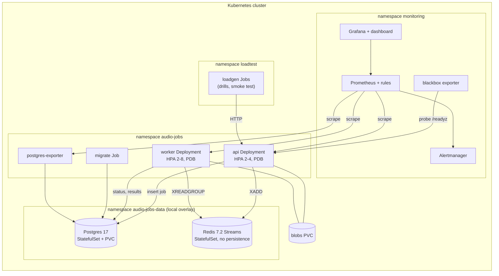

# platform-infra

Infrastructure to deploy, monitor, scale and recover [audio-jobs](https://github.com/imperiobaal69-web/audio-jobs), a Go job-processing service (HTTP API and workers on Postgres and Redis Streams):

- Kubernetes manifests (kustomize base plus `local` and `gke` overlays)
- a Prometheus and Grafana monitoring stack, with SLO alert rules tested by promtool
- six scripted failure drills with recorded results
- on-call runbooks
- Terraform for a private GKE environment on Google Cloud
- CI that checks all of it and deploys to a throwaway kind cluster

What is real and what is not:

- Real, and measured here. Everything in the local overlay runs on a single-node Kubernetes cluster (Colima with k3s on a MacBook, 4 vCPU, 6 GiB, 20 GiB disk, Kubernetes 1.35). All numbers in this README come from the drill scripts in `drills/` and are recorded in `drills/results/`.
- Written, validated, never applied. The Terraform and the `gke` overlay describe a production-style GCP environment. CI runs `terraform fmt`, `validate`, tflint and trivy on the Terraform and kubeconform on the overlay, but there is no GCP project behind it. Nothing has been created in the cloud, and none of the cloud-specific behaviour (Cloud SQL failover, Workload Identity, Filestore) has been exercised.

## Architecture



Every namespace starts from default-deny NetworkPolicies, ingress and egress, and the only allowed flows are the arrows above, plus DNS. Pods run as non-root with a read-only root filesystem, all capabilities dropped and the RuntimeDefault seccomp profile, and no pod mounts a Kubernetes API token.

On GKE the `audio-jobs-data` namespace does not exist, and the managed services take its place:

| Component | Local overlay | GKE overlay and Terraform |
|---|---|---|
| Kubernetes | Colima k3s (CI: kind), one node | regional private GKE Standard, Dataplane V2, node pool autoscaling 1 to 4 per zone, shielded nodes, release channel |
| Postgres | StatefulSet, 2 Gi local-path PVC, password auth | Cloud SQL Postgres 17, private IP only, TLS, regional HA, PITR backups; IAM database auth through the Cloud SQL Auth Proxy sidecar, so no password exists |
| Redis | StatefulSet, no persistence | Memorystore Redis 7.2, private services access, no persistence |
| Uploads | ReadWriteOnce PVC | Filestore (ReadWriteMany) through the CSI driver |
| Images | built into the VM's Docker | Artifact Registry, cleanup policies, immutable tags |
| Identity | per-component ServiceAccounts | the same, bound to Google service accounts with Workload Identity; least-privilege roles |
| CI access to GCP | n/a | GitHub OIDC through Workload Identity Federation, limited to this repository; no service account keys |
| Terraform state | n/a | GCS bucket with versioning (`terraform/bootstrap`) |

## Repository layout

```
k8s/base/              workload: Deployments, HPAs, PDBs, probes, NetworkPolicies, migration Job, exporter
k8s/overlays/local/    in-cluster Postgres and Redis, laptop sizing, shorter queue timeouts
k8s/overlays/gke/      Cloud SQL proxy sidecars, Workload Identity, Filestore, egress to private services
monitoring/            chart values, PodMonitors, Probe, alert rules + promtool tests, Grafana dashboard
drills/                six failure drills; drills/results/ holds what they recorded
docs/runbooks/         one on-call page per alert family
docs/                  SLOs, observability, scaling, secrets
terraform/             modules (network, gke, cloudsql, memorystore, artifact-registry,
                       workload-identity, github-oidc), environments/prod, bootstrap (state bucket)
scripts/               deploy, rollout guard, smoke test, monitoring install, static checks
.github/workflows/     CI
```

## Running it locally

You need macOS or Linux with Homebrew, and a checkout of audio-jobs next to this repository.

```bash
brew install colima docker kubectl helm jq shellcheck kubeconform terraform tflint trivy
colima start --kubernetes --cpu 4 --memory 6 --disk 20 --runtime docker
docker build -t audio-jobs:local ../audio-jobs      # k3s uses the VM's Docker images
scripts/monitoring-up.sh                            # kube-prometheus-stack, blackbox, rules, dashboard
scripts/deploy.sh local                             # secrets, datastores, migration, guarded rollouts
scripts/smoke.sh                                    # 30 jobs through the API; all must succeed
```

`scripts/deploy.sh` applies the overlay, waits for the schema migration and then rolls out api and worker through `scripts/rollout-guard.sh`. If a rollout does not become ready before its progress deadline, the guard rolls it back.

Static checks are the same commands CI runs:

```bash
scripts/check.sh                 # shellcheck, kubeconform (both overlays + monitoring), promtool, terraform
```

Grafana: `kubectl -n monitoring port-forward svc/kube-prometheus-stack-grafana 3000:80`.

## Failure drills

Each drill is a Bash script (`set -euo pipefail`, shellcheck clean). It waits for a steady state, starts load from `loadgen` Jobs inside the cluster, injects one fault, measures, and writes `drills/results/<drill>.json`. The measurements:

- detection: the time until the system itself reacts to the fault
- recovery: the time until the stated criterion is met
- accepted / lost: jobs the API accepted, and accepted jobs that never succeeded. This is computed by the load generator, which follows every job to a terminal state and checks its result.
- rejected at submit: submissions that got an error or no answer during the outage. These were never accepted, so a client would retry them.
- alerts: every `AudioJobs*` alert that went pending or firing during the drill, and when

| Drill | Fault | Detection | Recovery | Accepted | Lost | Rejected at submit | Runbook |
|---|---|---|---|---|---|---|---|
| [01-hpa-scale-out](drills/results/01-hpa-scale-out.json) | 3 load generators submitting 36000 jobs over 124.9s | 28.0 s (worker HPA desired replicas above minimum) | 80.1 s (both HPAs back at minimum after the load stops) | 36000 | 0 | 0 | [capacity](docs/runbooks/capacity.md) |
| [02-worker-kill](drills/results/02-worker-kill.json) | 2 worker pods force-deleted with 7 jobs in flight | 3.5 s (replacement worker pod ready) | 38.6 s (every job in flight at the kill has succeeded) | 150 | 0 | 0 | [workers-unavailable](docs/runbooks/workers-unavailable.md) |
| [03-postgres-restart](drills/results/03-postgres-restart.json) | postgres-0 killed (sigkill), kept down 30s, restarted on the same volume | 11.2 s (first API pod fails readiness and leaves the Service) | 36.2 s (Postgres ready and every API pod back in the Service) | 2331 | 0 | 69 | [postgres-down](docs/runbooks/postgres-down.md) |
| [04-redis-restart](drills/results/04-redis-restart.json) | redis-0 killed (sigkill), kept down 30s, restarts with an empty dataset | 9.1 s (first API pod fails readiness and leaves the Service) | 63.4 s (every job accepted before and during the outage has finished) | 2400 | 0 | 0 | [redis-down](docs/runbooks/redis-down.md) |
| [05-eviction](drills/results/05-eviction.json) | 4 pods evicted through the Eviction API under load | n/a (planned disruption; PDBs pace it) | 11.1 s (all evicted pods replaced and ready) | 2400 | 0 | 0 | [workers-unavailable](docs/runbooks/workers-unavailable.md) |
| [06-bad-deploy](drills/results/06-bad-deploy.json) | API revision listening on the wrong port; readiness never passes | 60.7 s (Deployment exceeds progressDeadlineSeconds (60s); rollout-guard sees it) | 60.8 s (previous revision fully rolled out again) | 3000 | 0 | 0 | [bad-deploy](docs/runbooks/bad-deploy.md) |

What each drill showed:

- 01, HPA scale-out. Three load generators pushed 36,000 jobs at about 299 jobs/s. Workers scaled from 2 to 5 (71 s to peak) and the API from 2 to 4. Both were back at the minimum 80 s after the load stopped. The per-second replica timeline is in `drills/results/01-hpa-scale-out.timeline.csv`.
- 02, worker kill. Both workers were force-deleted with 7 jobs in flight. All 7 were retried by the replacement workers once their deliveries timed out, the first after 23.8 s, and all 150 jobs of the run succeeded.
- 03, Postgres crash. The container was SIGKILLed and kept down for 30 s. Postgres ran WAL crash recovery on restart ("database system was not properly shut down; automatic recovery in progress"). The 70,134 jobs committed before the crash were identical afterwards (same count, and the same md5 over every job's id and status). Both API pods left the Service within 11.8 s, so the outage was visible as refused connections. 69 of 2,400 submissions were rejected at submit, and every accepted job succeeded.
- 04, Redis restart. Redis came back empty, so the stream, the consumer group and the result cache were gone. Postgres still had every job, and the sweeper re-enqueued the ones stuck in `queued`. No submission was rejected: the API commits the job to Postgres first and accepts it even when the Redis enqueue fails, and the sweeper picks it up later.
- 05, eviction. All 4 api and worker pods were evicted through the Eviction API. The PodDisruptionBudgets refused 4 attempts and paced the drain. The new pods were ready 11.1 s after the first eviction, with no client errors.
- 06, bad deploy. The new API revision never became ready. With `maxUnavailable: 0`, the two old pods kept serving for the entire rollout (minimum ready endpoints: 2). At the 60 s progress deadline, `scripts/rollout-guard.sh` rolled back with no human involved.

Alerts. In drill 03, `AudioJobsPostgresDown` went pending at 25.7 s; in drill 04, `AudioJobsRedisDown` went pending at 20.6 s. Neither fired: both have `for: 1m` and the outages lasted about 30 s. That is intended, because a page should not go out for an outage the system recovers from on its own in half a minute. Readiness detected both outages in 9 to 12 s. Each result file also lists the burn-rate alerts with `firing_before_fault: true`. Those were already firing when the drill started, because the 1h and 3d windows still contained earlier drills and an unplanned VM disk-full incident on the same day. They say nothing about the drill's own fault.

To rerun a drill: `drills/03-postgres-restart.sh`. It takes 3 to 6 minutes and overwrites its result file. Results were recorded on 2026-10-20.

## SLOs and alerts

| SLO (30 days) | Target |
|---|---|
| Availability: synthetic `/readyz` probes through the API Service succeed | 99.5% |
| Job success: finished jobs end `succeeded`, not `dead` | 99.9% |
| Latency: jobs finish end to end within 5.12 s | 95% |
| Queue age: oldest unfinished accepted job | under 120 s |

Error budget alerts use multiwindow burn rates (14.4x over 1h/5m and 6x over 6h/30m page, 1x over 3d/6h is a ticket). Fast symptom alerts cover hard outages of the API, Postgres, Redis and the workers, and stuck rollouts. The rules have 27 entries and are unit-tested with promtool in `monitoring/tests/`. Details: [docs/slos.md](docs/slos.md), [docs/observability.md](docs/observability.md).

## Runbooks

[docs/runbooks/](docs/runbooks/README.md) has one page per alert family: [api-unavailable](docs/runbooks/api-unavailable.md), [error-budget-burn](docs/runbooks/error-budget-burn.md), [job-failures](docs/runbooks/job-failures.md), [job-latency](docs/runbooks/job-latency.md), [queue-age](docs/runbooks/queue-age.md), [postgres-down](docs/runbooks/postgres-down.md), [redis-down](docs/runbooks/redis-down.md), [workers-unavailable](docs/runbooks/workers-unavailable.md), [bad-deploy](docs/runbooks/bad-deploy.md), [capacity](docs/runbooks/capacity.md). Each page follows the same shape: impact, first five minutes, diagnosis, mitigation, how to confirm recovery. Every alert carries a `runbook_url` that points to its page.

## CI

`.github/workflows/ci.yml`:

- lint: shellcheck; kubeconform in strict mode against Kubernetes 1.35 for both overlays and, with CRD schemas, the monitoring objects; promtool rule checks and unit tests; a check that the generated PrometheusRule is up to date
- terraform: `fmt -check`, `init -backend=false` and `validate` for the bootstrap and prod configurations, tflint with the Google ruleset, and `trivy config` failing on MEDIUM or higher
- e2e: builds the audio-jobs image from its repository at a pinned commit, creates a kind cluster (Kubernetes 1.35.8), deploys the local overlay with `scripts/deploy.sh` and runs `scripts/smoke.sh`

## Deploying to GKE (not done)

The intended path, written down but not exercised:

1. `terraform/bootstrap`: create the state bucket.
2. `terraform/environments/prod`: copy `backend.hcl.example` and `terraform.tfvars.example`, then run `terraform init -backend-config=backend.hcl` and `terraform apply`.
3. Put the `terraform output` values into `k8s/overlays/gke`: image repository, Cloud SQL connection name, IAM user names, Memorystore address, private services CIDR, Google service account emails. The committed values are the ones the example tfvars would produce for the project `my-gcp-project`.
4. Install External Secrets Operator and the monitoring stack, then run `scripts/deploy.sh gke`.

## Known gaps

- Not production-real. Nothing here has run on GCP. The Terraform passes static checks, but a first `apply` against a real project would very likely need fixes: API enablement timing, quotas, organisation policies.
- Single node. The local cluster has one node, so zone spread, node failure and real drains cannot be tested. Drill 05 evicts every pod through the Eviction API, the way `kubectl drain` does, but without cordoning the only node.
- Shared resources. The local datastores share the node and its 4 vCPUs with the workload, the monitoring stack and the load generators. Throughput numbers describe this laptop, not a capacity plan.
- CPU autoscaling. The worker HPA scales on CPU. Queue lag (KEDA, see [docs/scaling.md](docs/scaling.md)) is the better signal for a job system, but it is not installed.
- Memorystore without AUTH or TLS. The application's Redis client takes an address only. The trivy findings for this are suppressed inline with that reason.
- Rejected submissions during an outage. When Postgres or Redis is down, the API leaves the Service after two failed readiness checks (up to 10 s). Submissions in that window, and while no endpoint is ready, fail. The drills count them. The load generator does not retry them, and a real client would need to.
- Local alert routing. Alertmanager routes to a null receiver locally. Alerts were verified through the Prometheus API during the drills, not through a pager.
